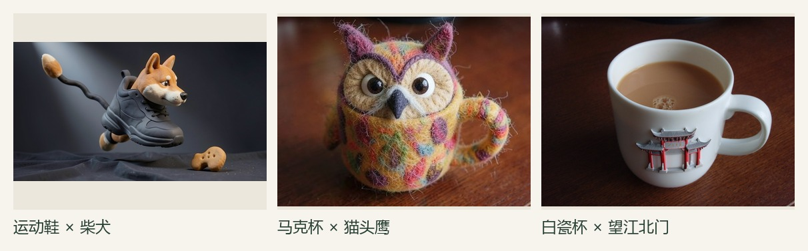
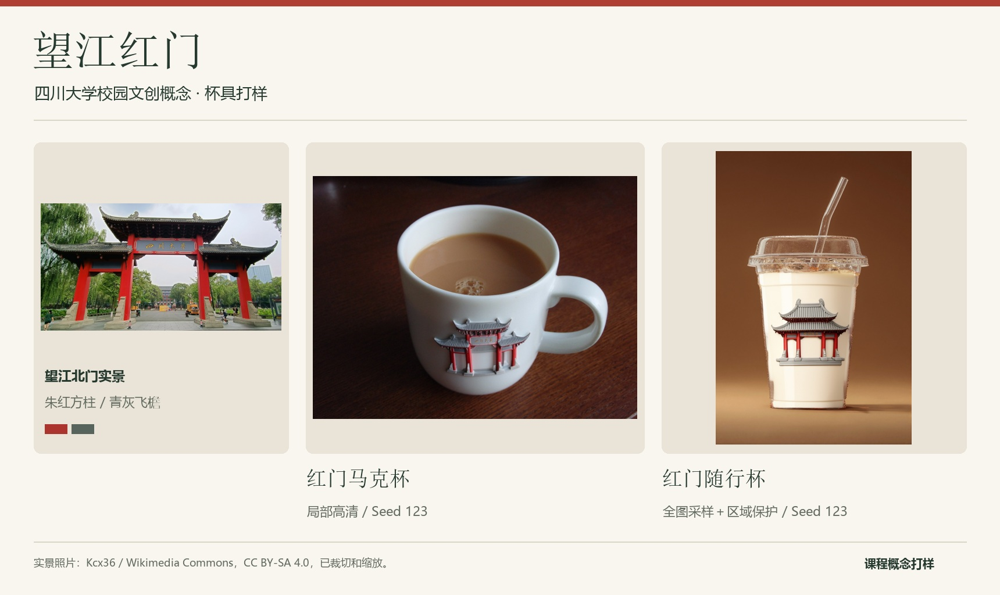
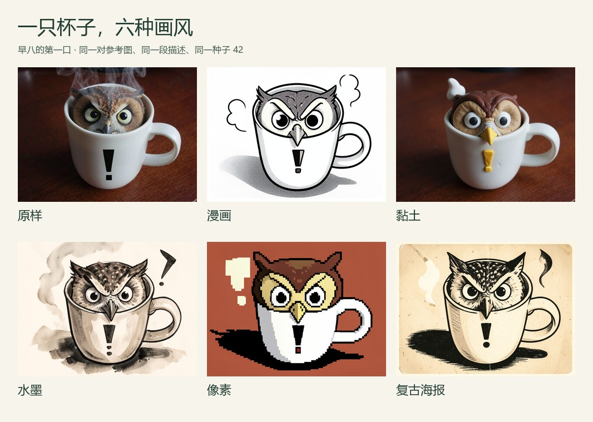
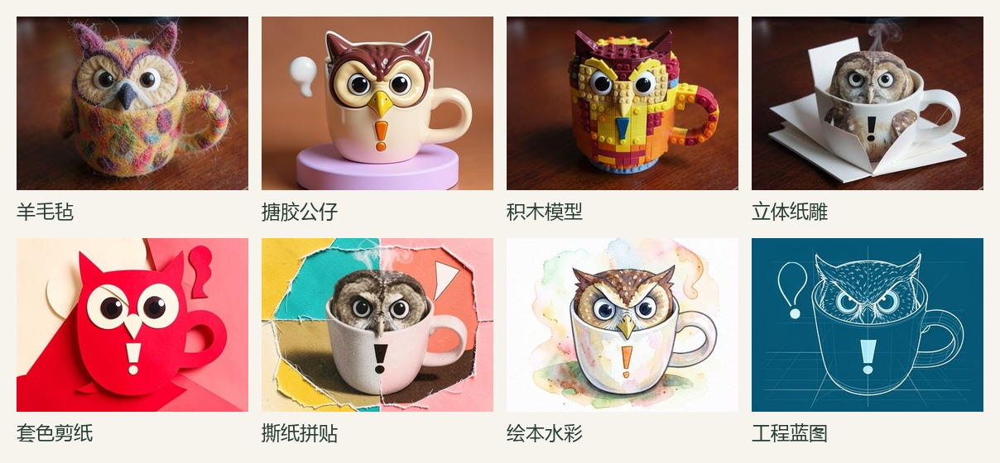
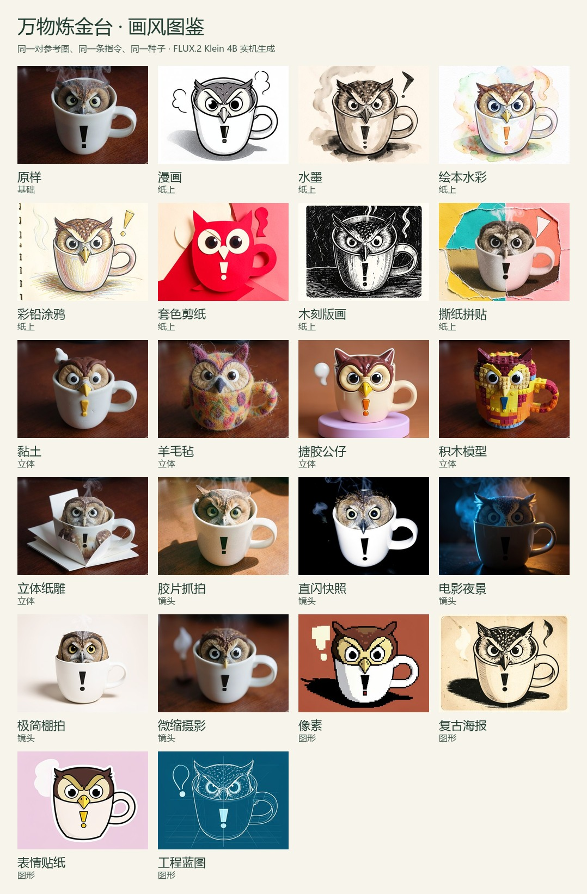
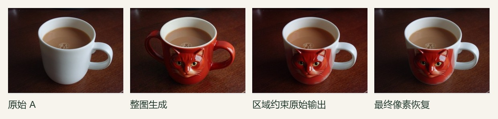
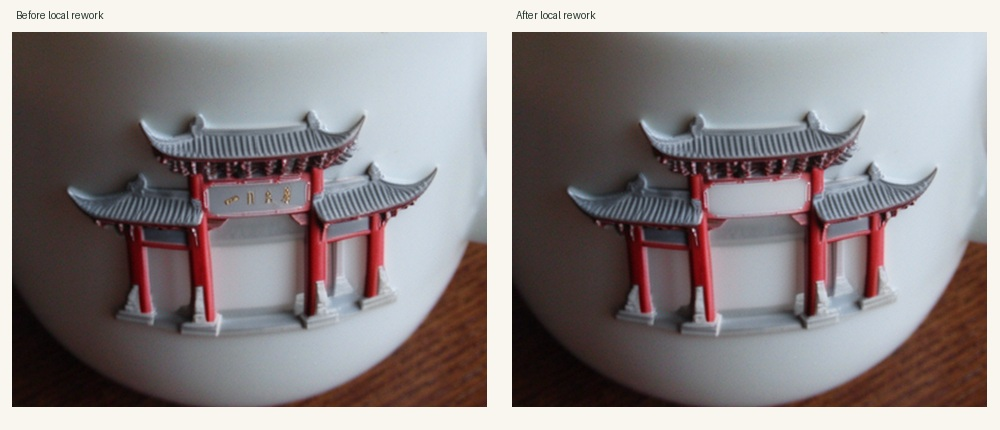

<h1>万物炼金台 · Alchemy Studio</h1>

用两张参考图，把日用品、宠物、校园地标和网络热梗重新组合。

<strong>双图融合 · 22 种画风 · 19 条快捷指令 · 区域保护 · 局部高清</strong>

<a href="#先看看能炼出什么">效果展示</a> · <a href="#同一只杯子换一种画法">画风对比</a> · <a href="#本项目做了哪些改进">项目改进</a> · <a href="#从空目录开始复现">开始复现</a>

给运动鞋借来柴犬的脸，把猫头鹰做成毛茸茸的马克杯，或者把四川大学望江北门烧进白瓷杯身。上传 A、B 两张图，选好用途和画风，再决定哪些地方可以改、哪些细节要保留。

生成基于 **FLUX.2 Klein 4B + ComfyUI**，交互由 **React + FastAPI** 实现。仓库包含应用源码、带来源的示例素材、工作流、安装脚本和真实实验结果。

## 先看看能炼出什么

### 把热梗带进日常

“早八的第一口”“谁的鞋先到教室”“DDL？一切都好”，还有站在望江北门前、面对复习资料捧脸呐喊的期末主角。

四组都在工作台的“热梗”分类里。选中后会载入两张原料、指令、种子和画风，可以直接生成，也可以改成自己的场景。

### 把校园地标做成文创

A 是杯子，B 是望江北门。保留杯口、把手、杯盖和吸管，把灰瓦飞檐与朱红方柱转成杯身浅浮雕。

实景照片由 Kcx36 拍摄，CC BY-SA 4.0，已裁切缩放。这里展示的是课程概念打样。素材记录见 [川大图源清单](input/scu_sources.json)。

## 同一只杯子，换一种画法

下面使用**同一对参考图、同一段用户描述、同一个种子 42**，切换画风预设。

材质也可以继续变。羊毛毡看得到纤维，积木露出颗粒和拼缝，纸雕带着折痕与层间阴影。

| 分组 | 可选画风 |
| --- | --- |
| 纸上 | 漫画、水墨、绘本水彩、彩铅涂鸦、套色剪纸、木刻版画、撕纸拼贴 |
| 立体 | 黏土、羊毛毡、搪胶公仔、积木模型、立体纸雕 |
| 镜头 | 胶片抓拍、直闪快照、电影夜景、极简棚拍、微缩摄影 |
| 图形 | 像素、复古海报、表情贴纸、工程蓝图 |
| 基础 | 原样 |

<strong>展开查看全部 22 种画风的实机图鉴</strong>

图鉴来自项目实际运行。画风由材质、笔触、色彩与布光提示控制，具体主体上的效果会有差异。

## 在工作台里怎么玩

1. **放入两张图**。A 通常提供结构或场景，B 提供外观、材质或表情；人物换装等指令会明确两张图的用途。
2. **挑用途与画风**。可以做陶瓷、球鞋、毛绒、水晶、建筑浮雕、梗图，也可以自定义要求。
3. **点常用指令**。选中的内容追加到输入框，已有文字保留，之后还能继续编辑。
4. **限定修改区域**。希望杯口、把手和背景保留时，在 A 上画修改区、保护区；较大变形可用整图生成。
5. **生成，再重炼**。比较候选、查看原始生成与最终合成，下载图片，或把结果作为下一轮 A 继续修改。

### 常用指令，少从空白框开始

| 想做什么 | 可以直接点 |
| --- | --- |
| 融合两样东西 | 保形换色、只换材质、把两样东西长在一起、给成品拍产品照 |
| 人物与宠物变身 | 把人物做成盲盒、宠物纪念小像、保留脸和姿势只换装、宠物上身变吉祥物、口袋天气兽 |
| 做点好玩的 | 让物品露出同款表情、DDL 一切都好、热梗换主角、梗图闯进校园 |
| 做校园文创 | 望江北门上杯身、校园地标做徽章、校园明信片 |
| 继续改细节 | 只改选中区域、清掉多余文字、保留功能部件 |

指令模板可以和画风组合。涉及局部修改时，需要先在画布中选定区域；涉及换装或梗图的模板会载入对应用途。所有模板都在 [creative.py](studio/creative.py)，可自行扩展。

## 本项目做了哪些改进

项目关注一个具体问题——**融合可以大胆，功能部件和编辑范围需要可控。**

### 1. 把“哪里能改”带进采样过程

修改区先取并集，再扣除保护区；分割可用时与原主体前景相交，随后仅向内羽化。蒙版通过 ComfyUI 原生 SetLatentNoiseMask 作用于 A 的编码 latent。

缩小到 latent 网格时，一个网格只要覆盖禁改像素，就会被保护。这种保守映射能保住较细的保护条，也会压缩可编辑空间；有效区域过小时会提示用户调整。实现位于 [regions.py](studio/regions.py)。

下图取自同输入、同种子的马克杯实验。整图生成多出左侧把手，区域约束后的输出沿用原杯结构。

### 2. 在原图坐标中恢复禁改像素

生成结果映回 A 的画布后，用源分辨率蒙版合成，并检查蒙版为零的位置是否与原 A 完全一致。原始生成、最终结果、蒙版和参数分别保存，便于检查采样与合成各自的作用。

**最终保护区零变化来自原像素恢复。** 它能保证指定像素保留，接缝是否自然、角色是否还原仍需另外判断。

### 3. 把像素预算集中到局部，再支持连续重炼

局部高清提取包含编辑范围和必要上下文的窗口，重新对齐蒙版、集中采样，再映回原图。这样可以在相同像素预算下，把更多采样分辨率分配给局部细节。实现位于 [local_detail.py](studio/local_detail.py)。

例如在已经生成的望江浮雕杯上，只选中牌匾，清掉不需要的字形。

这次记录中，6,984,100 个保护像素的变化数为 0。该结果对应这一张图和选区，完整记录见 [重炼实验](output/scu_detail/rework/summary.json)。

### 4. 让结果可以回看、比较和复现

每次任务记录实际提示词、参考图、随机种子、像素预算、蒙版和所有候选。预设样例、历史结果与本次生成分别标记。风格和用途独立选择，19 条指令明确图像角色与修改目标。

~~~mermaid
flowchart LR
    A["参考图 A"] --> P["规范化与参考图处理"]
    B["参考图 B"] --> P
    R["修改区与保护区"] --> M["区域运算与 latent 蒙版"]
    P --> G["双参考生成"]
    M --> G
    S["用途、画风与用户指令"] --> G
    G --> F["映回原图与像素恢复"]
    F --> H["候选对比、重炼与记录"]
~~~

### 有哪些实验证据

区域约束消融采用 **3 类物体 × 2 个种子**，成对固定参考图、提示词、模型和像素预算。

| 测量项 | 这六对实验的结果 |
| --- | --- |
| 整图生成的非编辑区平均 MAE | 15.273 |
| 区域约束原始输出的非编辑区平均 MAE | 3.194 |
| 最终恢复结果中，保护像素发生变化的数量 | 六张均为 0 |
| CPU 自动化检查 | 71 项测试、5 个子测试通过 |

MAE 是合成前相对 A 的 VAE 重建图测得的区域外误差，数值为六对样例等权平均，不能解释为审美或身份还原度。模型仍可能偏离角色、生成伪字或出现不自然边缘，失败图也保留在实验中。完整协议、数据和对照见 [方法说明](docs/METHOD.md)、[实验记录](output/region_evaluation/v3/results.json) 和 [完整对照图](output/region_evaluation/v3/comparison.jpg)。

## 从空目录开始复现

**同学用 Windows 游戏本，请先看 [Windows / WSL 安装指南](docs/CLASSMATE_SETUP.md)。** 仓库当前的启动器使用 Linux 环境，完成环境准备后可以执行统一安装入口。

~~~bash
bash scripts/install.sh
~~~

安装前可先运行 python3.10 scripts/check_environment.py，安装后用 .venv/bin/python scripts/check_environment.py --ready 排查本机依赖和文件。以下保留分步安装过程。

### 准备环境

| 项目 | 已验证或所需配置 |
| --- | --- |
| 推理系统 | Linux / WSL2，Ubuntu 22.04 |
| Python 与 PyTorch | Python 3.10，PyTorch 2.11.0+cu128 |
| 已验证 GPU | RTX 5070 Ti 16GB；8GB 显卡尚未实测 |
| 前端 | Node.js 20.19+ 或 22.12+，npm |
| 其他 | Git、curl、可用 NVIDIA 驱动，建议预留 25GB 磁盘 |
| 生成设置 | FLUX.2 Klein 4B distilled，4 steps，Euler，CFG 1 |

### 克隆，安装，启动

在 Linux 或 WSL2 中运行。已有对应 CUDA PyTorch 环境时，可以跳过 .venv 创建步骤，把它的 Python 绝对路径传给安装器。

~~~bash
git clone https://github.com/Auro-Auto/alchemy-studio.git
cd alchemy-studio

# 1. 创建 CUDA Python 环境
python3.10 -m venv .venv
.venv/bin/python -m pip install --upgrade pip
.venv/bin/python -m pip install torch==2.11.0 torchvision==0.26.0 --index-url https://download.pytorch.org/whl/cu128
.venv/bin/python -c 'import torch; print(torch.__version__, torch.cuda.is_available())'

# 2. 固定 ComfyUI 版本，下载并校验生成权重
bash scripts/setup_remote.sh "$(pwd)/.venv/bin/python"

# 3. 安装工作台依赖、分割模型，并执行 CPU 测试
bash scripts/setup_studio.sh

# 4. 构建前端并启动
cd web
npm ci
npm run build
cd ..
.venv/bin/python scripts/start_studio.py
~~~

浏览器打开 **http://127.0.0.1:8890**。

第一次会下载约 **8.26GB 生成权重**及约 **4.57MB 分割权重**，并需要加载模型。下载器校验文件大小和哈希，后续启动复用已有文件。仓库已经包含示例原料和效果预览。

### 第一张图，可以这样试

在底部“示例”中选“热梗”→“早八的第一口”，打开“风格”，选择“立体”→“羊毛毡”，点击“生成图片”。

这个示例会填好参考图、指令和种子。生成后切换“前后对比”，或点击“重炼此图”继续改局部。也可以先选“期末的望江红门”，试试校园场景和梗图组合。

### 在另一台电脑上演示

在推理电脑启动服务，然后建立 SSH 转发。

~~~bash
ssh -N -L 127.0.0.1:18890:127.0.0.1:8890 USER@GPU_HOST
~~~

演示电脑打开 **http://127.0.0.1:18890**，保持隧道终端开启。Windows 也可以传入自己的 SSH 别名与项目目录。

~~~powershell
.\scripts\connect_studio.ps1 -SshAlias my-gpu-pc -RemoteDirectory '~/projects/alchemy-studio'
~~~

更多模型来源、校验、原生工作流用法与故障处理见 [完整复现说明](REPRODUCTION.md)。应用面向本机和 SSH 使用，尚未提供公网多用户认证。

<strong>查看模型文件位置</strong>

| 文件 | 目录 |
| --- | --- |
| flux-2-klein-4b-fp8.safetensors | backend/ComfyUI/models/diffusion_models/ |
| qwen_3_4b_fp4_flux2.safetensors | backend/ComfyUI/models/text_encoders/ |
| flux2-vae.safetensors | backend/ComfyUI/models/vae/ |
| u2netp.onnx | models/segmentation/ |

权重清单见 [models.json](models.json)，分割下载与校验见 [prepare_segmentation.py](scripts/prepare_segmentation.py)。镜像不可达时，完整复现说明提供上游来源。

<strong>运行测试与真实 GPU 对照实验</strong>

~~~bash
.venv/bin/python -m pytest -q tests
# 以下真实实验需要先启动 Studio。
.venv/bin/python scripts/evaluate_studio.py --server http://127.0.0.1:8890 --cases experiments/studio_ablation.json --output-dir output/studio_eval/new_run
.venv/bin/python scripts/evaluate_regions.py --subject-mask --output output/region_evaluation/new_run
~~~

CPU 测试使用替身推理，检查接口、蒙版、合成与队列。真实推理由单独的 GPU 实验验证。

## 找到你想改的部分

| 路径 | 内容 |
| --- | --- |
| [studio/creative.py](studio/creative.py) | 画风描述与常用指令目录 |
| [input/meme_presets.json](input/meme_presets.json) | 可扩展热梗示例 |
| [studio/prompts.py](studio/prompts.py) | 双参考角色与用途提示编译 |
| [studio/regions.py](studio/regions.py) | 区域运算、latent 蒙版、像素恢复 |
| [studio/local_detail.py](studio/local_detail.py) | 局部高清窗口与坐标映射 |
| [web/src/](web/src/) | 工作台、区域编辑器、画风选择与历史 |
| [scripts/](scripts/) · [workflows/](workflows/) | 安装、运行、批量实验与原生工作流 |
| [output/](output/) · [docs/METHOD.md](docs/METHOD.md) | 结果、实验数据与方法说明 |

## 模型、素材与归属

生成使用 [BFL FLUX.2 Klein](https://huggingface.co/black-forest-labs/FLUX.2-klein-4B)、[ComfyUI](https://github.com/Comfy-Org/ComfyUI) 和 [官方工作流模板](https://github.com/Comfy-Org/workflow_templates)。分割采用 U²-Net 的 U2Netp，由 rembg 发布 ONNX 权重。本项目基于预训练模型实现上述编辑流程。

交互和画风研究参考 Fooocus、InvokeAI、Memegen 和 OpenAI 官方图像提示示例。预览和演示图来自项目实际运行；README 的组合图仅将已有结果排版展示。

各资源适用各自授权。实拍猫数据集声明 CC BY-NC-SA 4.0，望江北门照片为 CC BY-SA 4.0。来源、署名与处理记录见 [通用素材](input/sources.json)、[补充素材](input/additional_sources.json)、[川大素材](input/scu_sources.json)、[热梗素材](input/meme_sources.json) 和 [第三方说明](THIRD_PARTY_NOTICES.md)。原创代码尚未单独授予开源许可证。
