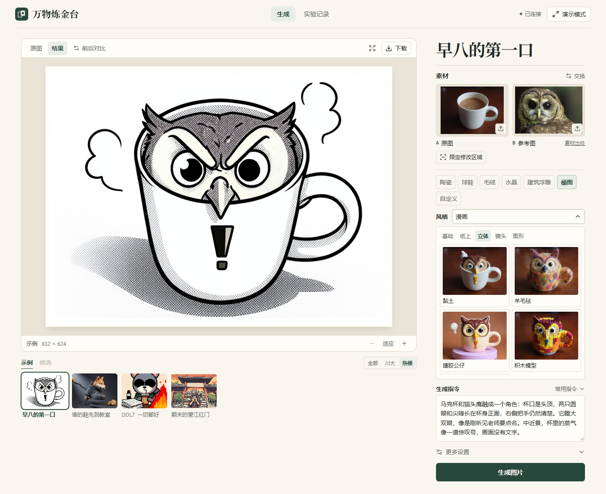
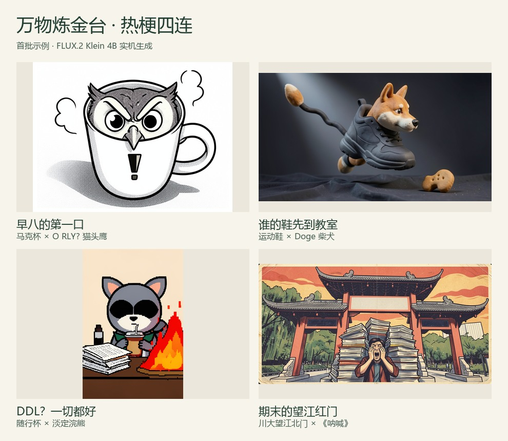

# 万物炼金台 · Alchemy Studio

把照片里的物品、宠物、角色和校园地标重新组合，做成文创概念、收藏玩具或反应图。基于 **FLUX.2 Klein 4B + ComfyUI**，提供 React 工作台、双图融合、手绘修改区与保护区、局部高清及实验记录。

## 功能

- 双参考图融合。A 提供结构或场景，B 提供角色、材质或表情。
- 22 种画风。水彩、彩铅、剪纸、木刻、拼贴、羊毛毡、积木、纸雕、胶片、直闪、电影夜景、贴纸、蓝图等，选择器显示真实生成预览。
- 19 条常用指令。保形换色、材质替换、人物盲盒、换装、热梗换主角、校园明信片等，点击追加，可继续编辑。
- 局部编辑与保护。手绘区域结合 CPU 主体分割、latent 采样蒙版与最终原像素恢复。
- 局部高清与重炼。集中采样编辑窗口，也可将生成图作为下一轮 A。
- 任务与实验记录。候选、原始生成、最终合成、蒙版、提示词、种子和耗时留档，支持前后比较和 JSON 导出。

完整对照见 [22 种画风图鉴](output/creative_styles/style-atlas.jpg)。

## 快速复现

完整安装、模型下载校验与故障处理见 **[REPRODUCTION.md](REPRODUCTION.md)**。

已验证 Linux / WSL2 Ubuntu 22.04、Python 3.10、PyTorch 2.11.0+cu128、RTX 5070 Ti 16GB、ComfyUI 0.44.0。8GB 显卡尚未实测。前端需要 Node.js 20.19+ 或 22.12+。

~~~bash
git clone https://github.com/Auro-Auto/alchemy-studio.git
cd alchemy-studio
# 传入已装指定 CUDA PyTorch 的 Python，首次下载约 8.26GB 权重。
bash scripts/setup_remote.sh /absolute/path/to/cuda/python
bash scripts/setup_studio.sh
cd web
npm ci
npm run build
cd ..
.venv/bin/python scripts/start_studio.py
~~~

推理电脑浏览器打开 **http://127.0.0.1:8890**。另一台 Windows 电脑可配置自己的 SSH 别名，传入远程目录。

~~~powershell
.\scripts\connect_studio.ps1 -SshAlias my-gpu-pc -RemoteDirectory '~/projects/alchemy-studio'
~~~

脚本转发本机 18890 至远程 8890。应用面向本机与 SSH 使用，尚未提供公网多用户认证。

## 所需文件

仓库包含应用源码、前端锁文件、原生工作流、安装与实验脚本、测试、示例输入、画风预览和演示结果。生成权重由 [models.json](models.json) 指定下载地址、大小与 SHA256，安装器负责下载校验。CPU 分割权重由 [prepare_segmentation.py](scripts/prepare_segmentation.py) 下载校验。

| 文件 | 目录 |
| --- | --- |
| flux-2-klein-4b-fp8.safetensors | backend/ComfyUI/models/diffusion_models/ |
| qwen_3_4b_fp4_flux2.safetensors | backend/ComfyUI/models/text_encoders/ |
| flux2-vae.safetensors | backend/ComfyUI/models/vae/ |
| u2netp.onnx | models/segmentation/ |

首次安装需要 Git、curl、网络和足够磁盘。个人上传、任务数据库与日志由各自部署生成。

## 使用

1. 选示例，或上传 A、B 两张 PNG、JPEG、WebP。
2. 选择用途与画风，用“常用指令”填入要求。
3. 在 A 上限定修改区与保护区，也可使用整图生成。
4. 设置候选数、种子和 0.5 / 1.0 MP 像素预算，点击生成。
5. 比较、下载，或从历史恢复参数继续重炼。

川大例子包括望江北门杯身浮雕和“期末的望江红门”。素材署名见 input/ 来源清单。

## 方法与验证

方法见 [METHOD.md](docs/METHOD.md)。区域运算、保护区扣除、向内羽化、保守 latent 尺度映射、局部采样及源像素恢复位于 studio/regions.py 与 studio/local_detail.py。

保护区外零变化来自最终原像素恢复，应与模型原始保真度分开评价。模型仍可能改变身份、结构或生成不自然接缝。参考匹配分是启发式分数，不能衡量审美和语义质量。

~~~bash
.venv/bin/python -m pytest -q tests
# 以下真实实验需要先启动 Studio。
.venv/bin/python scripts/evaluate_studio.py --server http://127.0.0.1:8890 --cases experiments/studio_ablation.json --output-dir output/studio_eval/new_run
.venv/bin/python scripts/evaluate_regions.py --subject-mask --output output/region_evaluation/new_run
~~~

公开快照对应的 CPU 检查为 71 项测试、5 个子测试通过。真实 GPU 结果位于 output/，包括早期失败与后续改进。22 种画风预览采用同一对参考图、同一指令和相同种子。

## 目录

| 路径 | 内容 |
| --- | --- |
| studio/ | API、队列、提示编译、分割、区域与局部处理 |
| web/ | React / Vite 源码与 npm 锁文件 |
| scripts/ | 安装、模型下载、启动、SSH、实验与工作流工具 |
| workflows/ | 上游原始模板与派生 API / UI 工作流 |
| input/ | 示例输入、来源清单与热梗预设 |
| experiments/、tests/ | 实验配置与 CPU 检查 |
| output/ | 公开示例、预览、实验记录 |
| docs/ | 方法、早期基线与调研 |

## 来源与许可

生成使用 [BFL FLUX.2 Klein](https://huggingface.co/black-forest-labs/FLUX.2-klein-4B)、[ComfyUI](https://github.com/Comfy-Org/ComfyUI) 和 [官方工作流模板](https://github.com/Comfy-Org/workflow_templates)。分割采用 [U²-Net](https://github.com/xuebinqin/U-2-Net)，通过 [rembg](https://github.com/danielgatis/rembg) 发布 ONNX 权重。

画风与交互研究参考 Fooocus、InvokeAI、Memegen 和 OpenAI 官方图像提示指南。各资源适用各自授权，详见 [第三方说明](THIRD_PARTY_NOTICES.md)。实拍猫数据集声明 CC BY-NC-SA 4.0，望江北门照片为 CC BY-SA 4.0。原创代码尚未单独授予开源许可证。
