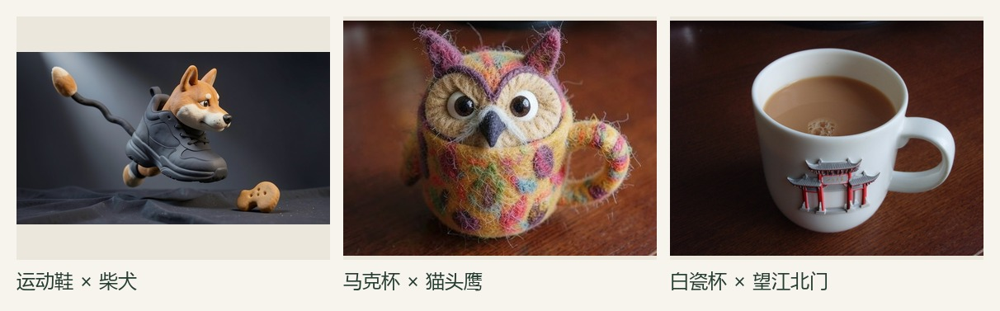
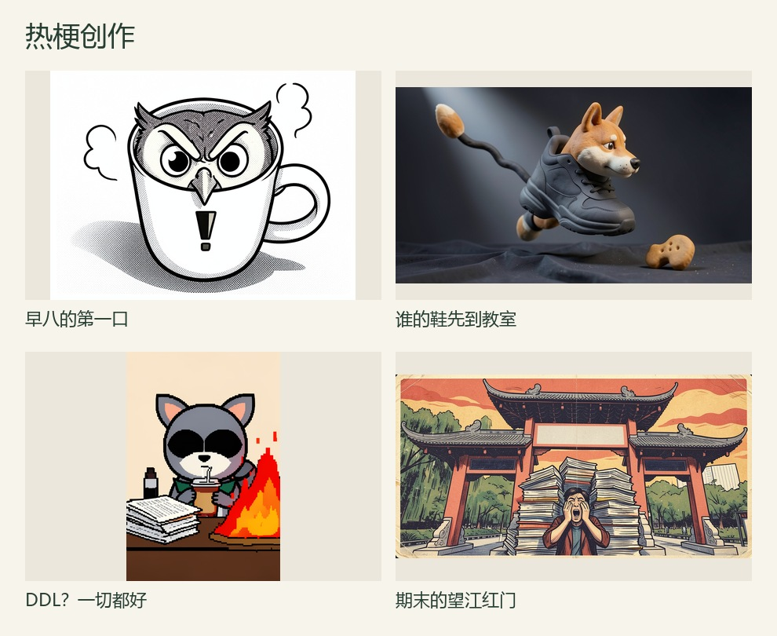
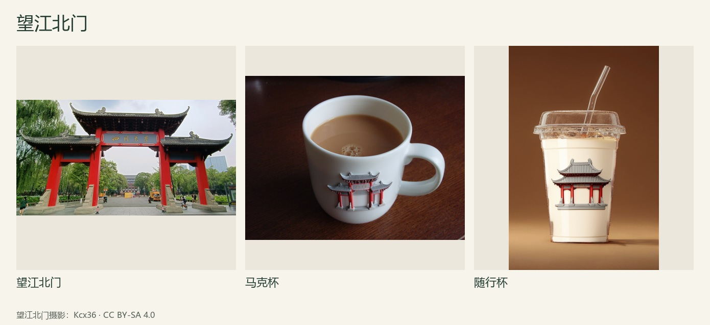
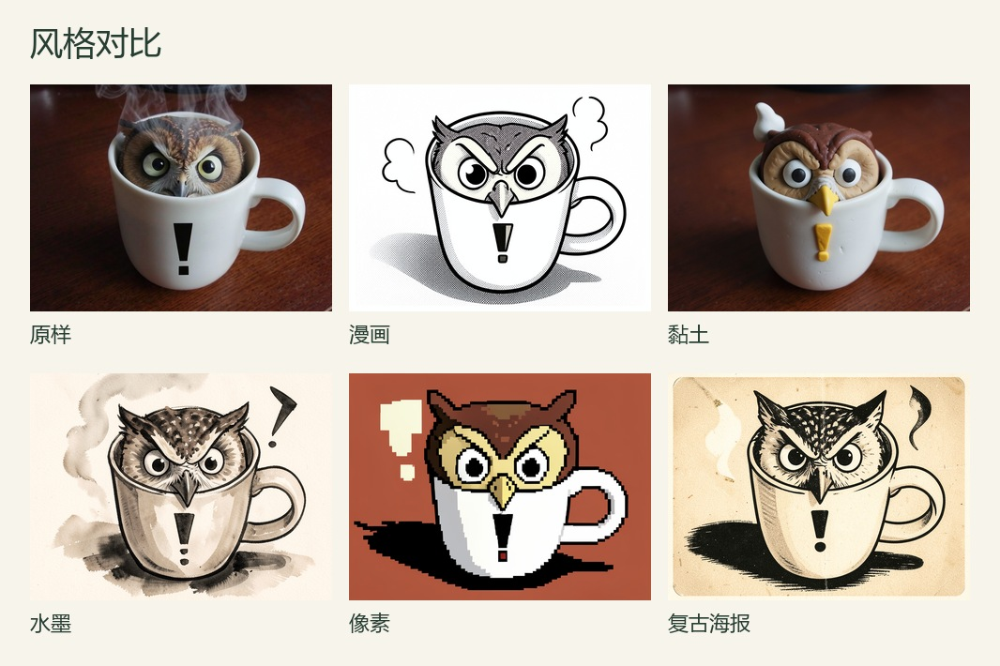
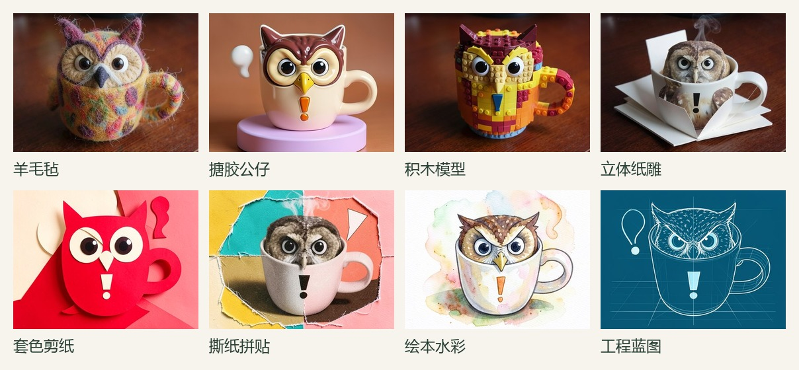
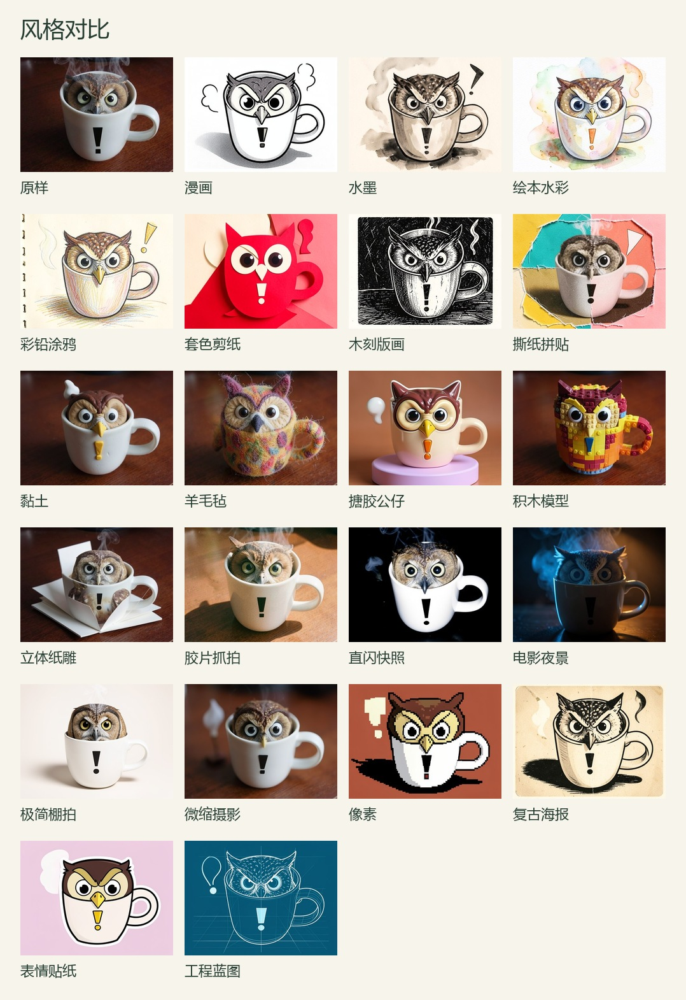
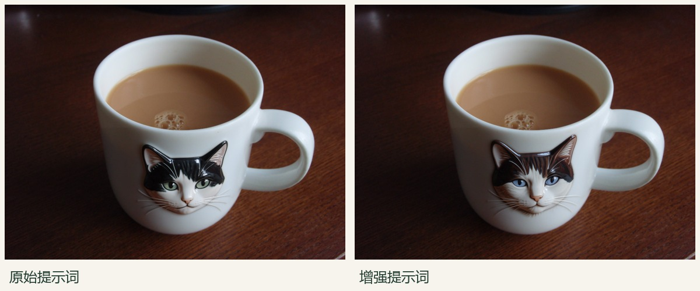
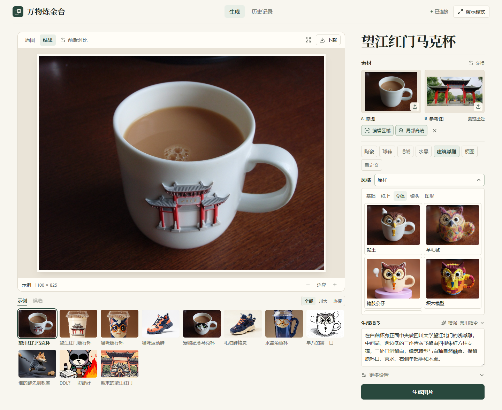
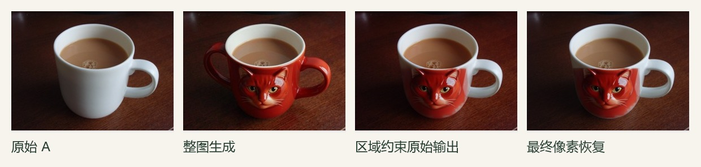
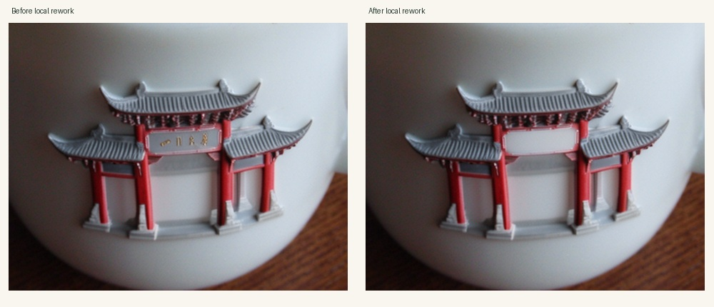

<h1>万物炼金台</h1>

把两张图片，变成一个新作品。

<a href="#效果展示">效果展示</a> · <a href="#风格对比">风格对比</a> · <a href="#项目创新">项目创新</a> · <a href="#安装与运行">安装运行</a>

上传两张参考图，把角色、材质或校园地标融入日常物品。选择风格，框定修改范围，保留需要的结构与细节。

## 效果展示

### 热梗创作

“早八的第一口”“谁的鞋先到教室”“DDL？一切都好”，还有站在望江北门前、面对复习资料捧脸呐喊的期末主角。

在“示例 → 热梗”中选择场景，或替换图片、修改指令。

### 校园文创

A 是杯子，B 是望江北门。把灰瓦飞檐与朱红方柱转成杯身浅浮雕，沿用原杯已有的杯口、把手、杯盖或吸管。

## 风格对比

固定参考图、描述与种子 42，切换画风。

材质也可以继续变。羊毛毡看得到纤维，积木露出颗粒和拼缝，纸雕带着折痕与层间阴影。

| 分组 | 可选画风 |
| --- | --- |
| 纸上 | 漫画、水墨、绘本水彩、彩铅涂鸦、套色剪纸、木刻版画、撕纸拼贴 |
| 立体 | 黏土、羊毛毡、搪胶公仔、积木模型、立体纸雕 |
| 镜头 | 胶片抓拍、直闪快照、电影夜景、极简棚拍、微缩摄影 |
| 图形 | 像素、复古海报、表情贴纸、工程蓝图 |
| 基础 | 原样 |

<strong>全部画风</strong>

## 提示词增强

将文字要求整理为“融合目标 / 材质与光影 / 保留与约束”，支持流式显示、中止和回退。增强器复用 Qwen3-4B 权重，只读取文字。

五类指令在 RTX 5070 Ti 16GB 上耗时约 13–17 秒。增强仍可能改变角色颜色，可编辑结果或回退原文。[增强测试](docs/PROMPT_ENHANCE_VALIDATION.md)

## 使用方法

1. **放入两张图**。A 通常提供结构或场景，B 提供外观、材质或表情；人物换装等指令会明确两张图的用途。可接受的高像素图片会自动等比缩至 20MP 内，上传仍受 20MB 文件上限与解压保护限制。
2. **挑用途与画风**。可以做陶瓷、球鞋、毛绒、水晶、建筑浮雕、梗图，也可以自定义要求。
3. **点常用指令**。选中的内容追加到输入框，已有文字保留，之后还能继续编辑。
4. **选择编辑区域**。希望杯口、把手和背景保留时，在 A 上画修改区、保护区；较大变形可用整图生成。
5. **生成，再重炼**。比较候选、查看原始生成与最终合成，下载图片，或把结果作为下一轮 A 继续修改。

### 常用指令

| 想做什么 | 可以直接点 |
| --- | --- |
| 融合两样东西 | 保形换色、只换材质、形态融合、产品照 |
| 人物与宠物变身 | 人物盲盒、宠物纪念小像、人物换装、宠物吉祥物、口袋天气兽 |
| 做点好玩的 | 表情移植、DDL 一切都好、热梗换主角、校园梗图 |
| 做校园文创 | 地标浮雕、校园徽章、校园明信片 |
| 继续改细节 | 只改选中区域、清掉多余文字、保留功能部件 |

画风可与指令组合，局部编辑需先框选区域。模板位于 [creative.py](studio/creative.py)。

## 项目创新

区域约束、像素恢复与局部采样控制融合范围，并支持在结果上继续编辑。

### 区域控制

修改区先取并集，再扣除保护区；分割可用时与原主体前景相交，随后仅向内羽化。蒙版通过 ComfyUI 原生 SetLatentNoiseMask 作用于 A 的编码 latent。

缩小到 latent 网格时，一个网格只要覆盖禁改像素，就会被保护。这种保守映射能保住较细的保护条，也会压缩可编辑空间；有效区域过小时会提示用户调整。实现位于 [regions.py](studio/regions.py)。

同输入、同种子对比中，整图生成多出一个把手，区域约束保留了原杯结构。

### 像素恢复

生成结果映回 A 的画布后，以源分辨率蒙版恢复禁改像素。保护区与规范化后的 A 一致；该保证来自最终像素合成，接缝与角色还原度仍取决于生成结果。任务分别保存原始生成、最终结果、蒙版和参数。

### 局部高清与连续编辑

局部高清提取包含编辑范围和必要上下文的窗口，重新对齐蒙版、集中采样，再映回原图。这样可以在相同像素预算下，把更多采样分辨率分配给局部细节。实现位于 [local_detail.py](studio/local_detail.py)。

在望江浮雕杯上框选牌匾，即可继续清理多余字形。

牌匾重炼实验中，6,984,100 个保护像素均未变化。[实验记录](output/scu_detail/rework/summary.json)

### 候选对比与任务记录

任务保存提示词、参考图、随机种子、像素预算、蒙版与全部候选，可回看、比较或继续编辑。

~~~mermaid
flowchart LR
    A["参考图 A"] --> P["规范化与参考图处理"]
    B["参考图 B"] --> P
    R["修改区与保护区"] --> M["区域运算与 latent 蒙版"]
    P --> G["双参考生成"]
    M --> G
    S["用途、画风与用户指令"] --> G
    G --> F["映回原图与像素恢复"]
    F --> H["候选对比、重炼与记录"]
~~~

### 实验结果

区域约束消融采用 **3 类物体 × 2 个种子**，成对固定参考图、提示词、模型和像素预算。

| 测量项 | 六组均值或结果 |
| --- | --- |
| 整图生成的非编辑区平均 MAE | 15.273 |
| 区域约束原始输出的非编辑区平均 MAE | 3.194 |
| 最终恢复结果中，保护像素发生变化的数量 | 六张均为 0 |
| 自动化检查 | 86 项测试、5 个子测试通过 |

MAE 为合成前非编辑区相对 A 的 VAE 重建图的像素误差，按六组等权平均，不代表审美或身份还原度。角色、文字与接缝仍可能出现偏差。[方法](docs/METHOD.md) · [数据](output/region_evaluation/v3/results.json) · [对照图](output/region_evaluation/v3/comparison.jpg)

## 安装与运行

Windows 用户先完成 [WSL 环境配置](docs/CLASSMATE_SETUP.md)。在 Linux 或 WSL2 中运行安装器：

~~~bash
bash scripts/install.sh
~~~

安装前运行 `python3.10 scripts/check_environment.py` 检查环境；安装后运行 `.venv/bin/python scripts/check_environment.py --ready` 检查依赖与模型文件。

### 准备环境

| 项目 | 配置 |
| --- | --- |
| 推理系统 | Linux / WSL2，Ubuntu 22.04 |
| Python 与 PyTorch | Python 3.10，PyTorch 2.11.0+cu128 |
| 已验证 GPU | RTX 5070 Ti 16GB；8GB 显卡尚未实测 |
| 前端 | Node.js 20.19+ 或 22.12+，npm |
| 其他 | Git、curl、可用 NVIDIA 驱动，建议预留 25GB 磁盘 |
| 生成设置 | FLUX.2 Klein 4B distilled，4 steps，Euler，CFG 1 |

### 安装步骤

在 Linux 或 WSL2 中运行。已有对应 CUDA PyTorch 环境时，可以跳过 .venv 创建步骤，把它的 Python 绝对路径传给安装器。

~~~bash
git clone https://github.com/Auro-Auto/alchemy-studio.git
cd alchemy-studio

# 1. 创建 CUDA Python 环境
python3.10 -m venv .venv
.venv/bin/python -m pip install --upgrade pip
.venv/bin/python -m pip install torch==2.11.0 torchvision==0.26.0 --index-url https://download.pytorch.org/whl/cu128
.venv/bin/python -c 'import torch; print(torch.__version__, torch.cuda.is_available())'

# 2. 固定 ComfyUI 版本，下载并校验生成权重
bash scripts/setup_remote.sh "$(pwd)/.venv/bin/python"

# 3. 安装工作台依赖、分割模型，并执行 CPU 测试
bash scripts/setup_studio.sh

# 4. 构建前端并启动
cd web
npm ci
npm run build
cd ..
.venv/bin/python scripts/start_studio.py
~~~

浏览器打开 **http://127.0.0.1:8890**。

首次安装下载约 **8.26GB 生成权重**及约 **4.57MB 分割权重**，并校验大小与哈希。后续启动复用已有文件。

### 快速体验

在底部“示例”中选“热梗”→“早八的第一口”，打开“风格”，选择“立体”→“羊毛毡”，点击“生成图片”。

示例自动填入参考图、指令和种子。生成后可切换“前后对比”，或点击“继续编辑”修改局部。

### 远程访问

在推理电脑启动服务，然后建立 SSH 转发。

~~~bash
ssh -N -L 127.0.0.1:18890:127.0.0.1:8890 USER@GPU_HOST
~~~

演示电脑打开 **http://127.0.0.1:18890**，保持隧道终端开启。Windows 也可以传入自己的 SSH 别名与项目目录。

~~~powershell
.\scripts\connect_studio.ps1 -SshAlias my-gpu-pc -RemoteDirectory '~/projects/alchemy-studio'
~~~

[安装指南](REPRODUCTION.md) 包含模型下载、原生工作流与故障排查。应用用于本机或 SSH 访问，未提供公网多用户认证。

<strong>模型文件</strong>

| 文件 | 目录 |
| --- | --- |
| flux-2-klein-4b-fp8.safetensors | backend/ComfyUI/models/diffusion_models/ |
| qwen_3_4b_fp4_flux2.safetensors | backend/ComfyUI/models/text_encoders/ |
| flux2-vae.safetensors | backend/ComfyUI/models/vae/ |
| u2netp.onnx | models/segmentation/ |

[权重清单](models.json) · [分割模型下载](scripts/prepare_segmentation.py) · [备用下载源](REPRODUCTION.md#模型下载)

<strong>测试与实验</strong>

~~~bash
.venv/bin/python -m pytest -q tests
# 以下真实实验需要先启动 Studio。
.venv/bin/python scripts/evaluate_studio.py --server http://127.0.0.1:8890 --cases experiments/studio_ablation.json --output-dir output/studio_eval/new_run
.venv/bin/python scripts/evaluate_regions.py --subject-mask --output output/region_evaluation/new_run
~~~

CPU 测试覆盖接口、蒙版、合成与队列；生成效果与显存测试需运行 GPU 实验。

## 小组分工

| 成员 | 负责模块 |
| --- | --- |
| 罗旭威 | 素材与输入 |
| 顾祥瀚 | 生成与提示词 |
| 鲜超旭 | 分割与区域编辑 |
| 肖轩 | 工作台与接口 |

[详细分工](docs/TEAM_ROLES.md)

## 项目结构

| 路径 | 内容 |
| --- | --- |
| [studio/creative.py](studio/creative.py) | 画风描述与常用指令目录 |
| [input/meme_presets.json](input/meme_presets.json) | 可扩展热梗示例 |
| [studio/prompts.py](studio/prompts.py) | 双参考角色与用途提示编译 |
| [studio/regions.py](studio/regions.py) | 区域运算、latent 蒙版、像素恢复 |
| [studio/local_detail.py](studio/local_detail.py) | 局部高清窗口与坐标映射 |
| [web/src/](web/src/) | 工作台、区域编辑器、画风选择与历史 |
| [scripts/](scripts/) · [workflows/](workflows/) | 安装、运行、批量实验与原生工作流 |
| [output/](output/) · [docs/METHOD.md](docs/METHOD.md) | 生成结果与实验方法 |

## 模型与素材

生成采用 [FLUX.2 Klein](https://huggingface.co/black-forest-labs/FLUX.2-klein-4B)、[ComfyUI](https://github.com/Comfy-Org/ComfyUI) 与 [官方工作流模板](https://github.com/Comfy-Org/workflow_templates)，分割采用 U²-Net 的 U2Netp / rembg ONNX 权重；前端与接口采用 React、FastAPI。

交互与画风参考 Fooocus、InvokeAI、Memegen 和 OpenAI 官方图像提示示例。

望江北门照片由 Kcx36 拍摄，CC BY-SA 4.0，已裁切缩放；实拍猫数据集声明 CC BY-NC-SA 4.0。川大相关作品为课程概念打样，不代表校方官方文创或背书。来源与授权见 [通用素材](input/sources.json)、[补充素材](input/additional_sources.json)、[川大素材](input/scu_sources.json)、[热梗素材](input/meme_sources.json) 和 [第三方许可](THIRD_PARTY_NOTICES.md)。原创代码未另行授予开源许可证。
