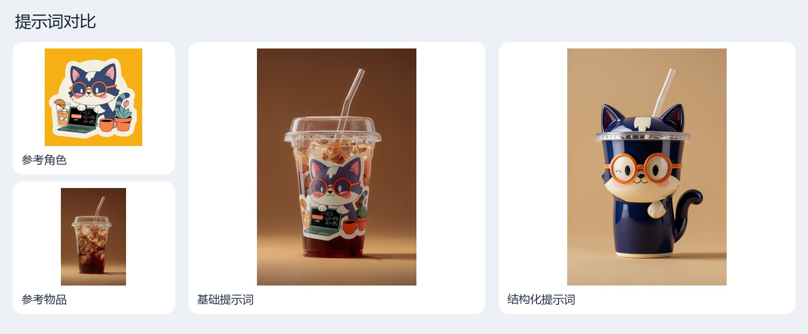
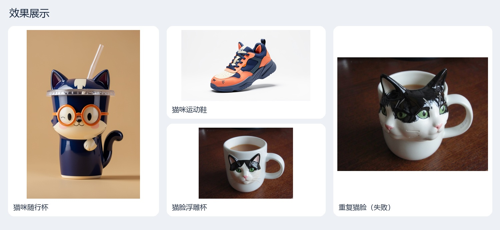

# 基线实验

使用 FLUX.2 Klein 4B distilled 的原生双参考工作流，比较普通融合提示与结构化提示。受测设备为 RTX 5070 Ti 16GB，生成模型为 FP8，文本编码器为 FP4，采样采用 4 步 Euler、CFG 1。



两图使用相同输入、种子 42 和 0.5MP。普通提示生成杯身贴图；指定耳朵、眼镜、尾巴的位置及陶瓷材质后，生成了立体猫杯。

## 运行

在项目根目录启动 ComfyUI：

```bash
.venv/bin/python scripts/start_backend.py
```

浏览器打开 `http://127.0.0.1:8188`，导入 `workflows/cat_tumbler_ui.json`，在节点 76 上传 `input/iced_drink_cup.png`，节点 81 上传 `input/comfy_cat.png`。运动鞋和实拍猫杯可分别使用 `cat_sneaker_ui.json`、`real_cat_mug_refined_ui.json` 及对应素材。

通过 SSH 访问 ComfyUI 时，在演示电脑运行 `scripts/connect_ui.ps1`，再打开 `http://127.0.0.1:18888`。保持隧道终端开启。

批量实验命令：

```powershell
python scripts/run_experiments.py --cases experiments/fusion_smoke.json --server http://127.0.0.1:18888 --output-dir output/fusion_smoke
```

本机运行时将 `--server` 改为 `http://127.0.0.1:8188`。环境安装见 [安装指南](../REPRODUCTION.md)，区域编辑方法见 [方法与实验](METHOD.md)。

## 结果

| 案例 | 输出尺寸 | 后端执行 | 上传到下载 | 输出观察 |
| --- | ---: | ---: | ---: | --- |
| 官方手袋＋标志 | 368×672 | 5.79 秒 | 7.26 秒 | 保留手袋形状，迁移颜色和标志 |
| 猫角色＋运动鞋 | 960×528 | 3.24 秒 | 4.94 秒 | 猫耳和配色融入鞋；眼镜细节遗漏 |
| 猫角色＋饮料杯，seed 42 | 592×880 | 3.43 秒 | 5.12 秒 | 立体猫耳、眼镜与尾巴把手 |
| 同输入，普通融合提示 | 592×880 | 3.27 秒 | 5.20 秒 | 杯身贴图 |
| 结构提示，seed 43 | 592×880 | 3.25 秒 | 5.23 秒 | 立体猫杯，局部细节变化 |
| 结构提示，1MP | 832×1248 | 6.47 秒 | 8.47 秒 | 立体猫杯，材质细节更丰富 |
| 实拍猫＋白瓷杯，初次 | 1168×880 | 6.88 秒 | 8.79 秒 | 重复猫脸、四只眼睛 |
| 实拍猫＋白瓷杯，改提示＋seed | 1168×880 | 6.76 秒 | 8.35 秒 | 单猫脸浮雕；耳朵未到杯口 |

后端耗时取 ComfyUI history 的 `execution_start` / `execution_success` 时间差，总耗时包含上传、轮询与下载。各值均为单次观测；首次调用包含模型加载，缓存状态不同。

1 秒间隔的 nvidia-smi 整卡采样峰值为 **10166MiB（约 9.93GiB）**。该值包含整卡占用，并非模型独占峰值。8GB 显卡尚未实测。



八次运行均完成推理和文件回传，其中包含贴图化、重复猫脸等失败结果。实拍猫的第二次生成同时更改了提示词和种子，不能单独归因于提示词；这些少量案例也不能估计通用成功率或身份还原度。

## 实验文件

- `input/`：原图；`sources.json`、`additional_sources.json` 记录来源与哈希。
- `workflows/`：官方模板、UI 工作流与 API 工作流。
- `experiments/fusion_smoke.json`：输入、提示词、种子与像素预算。
- `output/`：原始生成及各次 `run.json`，包含工作流、history 和执行参数。
- `output/results.json`、`output/results.csv`：实验索引。
- `models.json`：三个生成权重的来源、大小与 SHA256，总计约 8.26GB。

## 模型与素材

- [FLUX.2 官方项目](https://github.com/black-forest-labs/flux2) 与 [Klein 4B 模型卡](https://huggingface.co/black-forest-labs/FLUX.2-klein-4B)。
- [ComfyUI](https://github.com/Comfy-Org/ComfyUI) 与 [Klein 工作流文档](https://docs.comfy.org/tutorials/flux/flux-2-klein)。
- 模型、后端与素材分别适用各自许可。实拍猫素材含非商业使用限制，详见 [素材来源](../input/additional_sources.json)。
