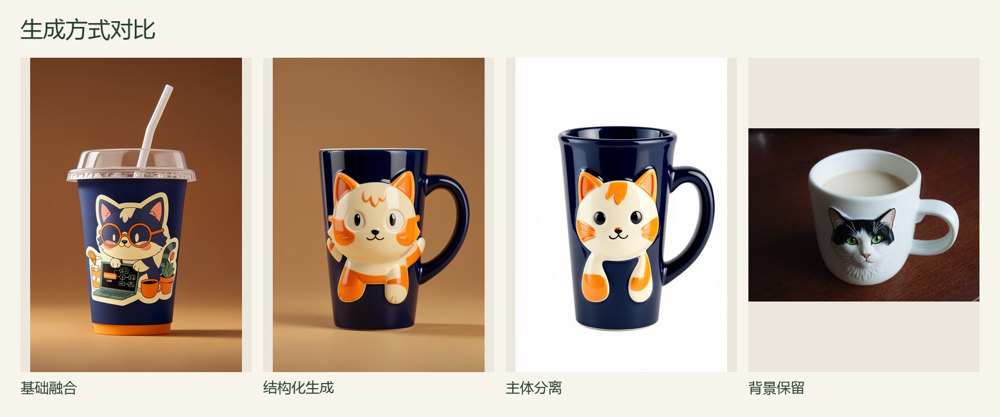

# 方法与实验

项目使用 FLUX.2 Klein 4B distilled 和 ComfyUI 双参考工作流：A 提供结构或场景，B 提供外观、配色或角色特征。分割、区域采样和像素恢复用于控制编辑范围，保留杯口、把手、吸管、鞋底等功能结构。

## 处理流程

```text
参考图 A/B → 方向、尺寸与颜色规范化 → 参考图处理 ─┐
用途、画风与用户文字 → 提示词编译 ───────────────┤
修改区、保护区 → 区域蒙版与采样窗口 ─────────────┤
                                                  ↓
                                     双参考生成 → 原始候选
                                                  ↓
                          像素恢复或背景合成 → 候选比较
                                                  ↓
                                  用户选择、下载与继续编辑
```

生成模型为 FP8，文本编码器为 FP4，采样采用 4 步 Euler、CFG 1。项目没有微调模型或训练质量评估器，主要实现参考图处理、提示编译、区域控制、局部高清、合成与任务管理。

## 区域控制

`studio/regions.py` 接收归一化矩形，计算修改区并集并扣除保护区。分割可用时，与 A 的前景概率 ≥ 0.5 区域相交，再向内羽化；分割不可用时采用手工区域。A 保留完整场景，B 可单独提取主体。前景相交适合保留原结构，较大形变可改用整图生成。

蒙版通过 ComfyUI 原生 `SetLatentNoiseMask` 绑定到 A 编码后的 latent，替代空 latent 输入。A 先对齐到 16 像素尺寸，避免 VAE 隐式中心裁剪造成错位。节点实现见 [ComfyUI VAE](https://github.com/Comfy-Org/ComfyUI/blob/bdb0816a292d221efeb6ec4ae41bcdff3f91fc86/comfy/sd.py) 和 [采样器](https://github.com/Comfy-Org/ComfyUI/blob/bdb0816a292d221efeb6ec4ae41bcdff3f91fc86/comfy/samplers.py)。

### 蒙版映射

直接缩小源蒙版可能丢失细保护条。实现通过积分图计算各 latent 格覆盖的源像素：只要覆盖禁改像素，该格就设为零，否则取柔和蒙版均值。没有强度大于 0.5 的有效格时，推理前提示扩大区域或提高分辨率。

这种保守映射会缩小可编辑范围。采样蒙版与源分辨率的最终蒙版分别保存；VAE 解码和边界感受野仍可能使原始生成改变选区外像素。

### 像素恢复

输出映回 A 的画布后，按源坐标蒙版合成，检查蒙版为零的位置是否与规范化原图完全一致。原始生成、最终合成、蒙版和指标均随任务保存。

最终保护区零变化来自原像素恢复，不代表模型本身的保真率，也不保证接缝自然。

### 局部高清

`studio/local_detail.py` 提取包含编辑范围与必要上下文的窗口，重建采样蒙版，将像素预算集中到局部，再映回原图。用户可在生成结果上选择“继续编辑”，设置新的修改区和保护区。

## 区域实验

`scripts/evaluate_regions.py` 使用马克杯、透明饮料杯、运动鞋三类输入，每类采用种子 42、123。每对固定 A/B、提示词、分辨率、模型和采样参数，比较整图生成、区域生成与最终像素恢复。

原始生成的非编辑区平均绝对误差（MAE，0–255）以 A 的 VAE 重建图为参照，减少编码重建误差的干扰；同时计算编辑区改变量与最终保护像素变化数。人工评价表用于角色可辨认、材质融合、功能结构、边缘自然四项 0/1/2 分评分，尚未填写。

仅使用矩形时曾出现桌面被染色的结果，见 [v1 对照](../output/region_evaluation/v1/comparison.jpg)。v2 加入前景相交，v3 增加保守 latent 映射。以下六组对照均使用 v3 的相同配置，共 12 次生成，详见 [参数与结果](../output/region_evaluation/v3/results.json) 和 [对照图](../output/region_evaluation/v3/comparison.jpg)。

| 物体 / seed | 整图生成非编辑区 MAE | 区域生成非编辑区 MAE |
| --- | ---: | ---: |
| 马克杯 / 42 | 18.305 | 4.947 |
| 马克杯 / 123 | 15.580 | 4.377 |
| 饮料杯 / 42 | 16.404 | 5.964 |
| 饮料杯 / 123 | 30.875 | 3.275 |
| 球鞋 / 42 | 4.585 | 0.330 |
| 球鞋 / 123 | 5.891 | 0.272 |

六组非编辑区 MAE 的等权平均由 15.273 降至 3.194，下降约 79.1%；编辑区 MAE 为 34.249–78.041。六张最终合成图的保护像素变化数均为零。

这些指标衡量像素变化，不代表画质提高或编辑语义正确。样例中仍有黑白猫变成红釉猫、鞋面呈贴图感等问题。不同版本使用不同蒙版定义，MAE 不作跨版本直接比较；角色身份、自然度和分割漏检尚需更广样本与人工评价。

## 提示词与参考图

基础对照使用简单融合说明；结构化配方指定 A 的轮廓、视角与功能部件，B 的配色、纹理与外观特征，并附加用途、画风和用户原文。人物换装、场景与梗图按各自任务组织指令。“单张脸”“保留吸管”等属于模型提示，工作流没有对应的部件检测器，仍可能遗漏或重复。

主体分割使用 U2Netp 的 CPU ONNX 推理，预处理遵循 rembg 会话约定。安装阶段下载并核验权重，推理时使用本地文件。

| 设置 | A 的生成参考 | B 的生成参考 | 合成 |
| --- | --- | --- | --- |
| 不提取主体、不保留背景 | 规范化原图 | 规范化原图 | 原始生成 |
| 提取主体、不保留背景 | 提取主体、白底合成，保留画布 | 前景裁剪、留边与白底合成 | 原始生成 |
| 保留背景、不提取主体 | 原始场景 | 规范化原图 | 单独提取 A 蒙版，用于背景合成 |
| 保留背景且提取主体 | 原始场景 | 前景裁剪、留边与白底合成 | 单独提取 A 蒙版，用于背景合成 |

输出尺寸按 A 的比例和像素预算确定。合成时等比适配到 A 的画布，必要时留边，不强制拉伸。

## 背景合成

将生成主体蒙版 `M_generated` 与原 A 蒙版 `M_A` 取并集，扩展柔和边缘，并限制在生成图有效覆盖范围内，得到 `M_edit`：

```text
output = M_edit × aligned_generation + (1 − M_edit) × original_A
```

原主体蒙版覆盖旧物体，生成蒙版容纳新增轮廓。工作台可切换原始生成与最终结果、查看蒙版，并下载当前视图。

实现检查 `M_edit == 0` 的 RGB 是否与规范化 A 完全一致。两个受测候选分别检查了 4,484,165 和 4,485,452 个保护像素，变化数均为零。该保证由自动分割与合成蒙版定义，不等于整张语义背景保真；半透明边缘、阴影、遮挡和新增部件仍可能不自然。

生成主体明显偏位、适配后遗漏原主体或编辑区几乎覆盖整图时，任务报错。界面操作记录见 [界面检查](../output/ui/browser-report.json)。

## 候选评分

`reference_heuristic_v2` 输出 0–100 分：

```text
score = 0.45 × shape_score
      + 0.25 × 100 × structure_similarity
      + 0.30 × 100 × palette_similarity
```

| 分项 | 计算方法 | 范围 |
| --- | --- | --- |
| 前景形态 `shape_score` | 最大连通区域占比、贴边情况、前景面积，权重为 0.45／0.30／0.25 | 几何完整度 |
| A 轮廓 `structure_similarity` | 前景包围框等比归一、居中到 128 像素画布，计算二值 IoU | 外轮廓相似度 |
| B 配色 `palette_similarity` | 前景 HSV 75 桶直方图交集，排除背景 | 配色相似度 |

参考描述子缓存避免重复分割。描述子缺失或计算失败时退回 `mask_geometry_v1` 并记录原因；分割不可用时可能没有分数。不同评分版本不直接混用。

同输入、种子 42、0.5MP 的一组结果中，杯身贴图得分 79.32，立体融合结果为 64.05。轮廓更接近参考可能得到更高分，也可能抑制有意的结构变化；材质或照明变化同样会影响配色分。因此分数只辅助比较轮廓与配色，不衡量角色身份、融合语义或审美，最终由用户选择。

## 工作流实验



前三组固定输入、种子 42 和 0.5MP，比较基础提示、结构化配方及主体提取；第四组使用独立的实拍猫马克杯输入，检查背景合成。配置见 [studio_ablation.json](../experiments/studio_ablation.json)，结果见 [results.json](../output/studio_eval/20261108T051221Z/results.json)。四个任务共生成六张图片。

主体提取组含两个种子，与其他组比较时使用相同种子；背景合成组因输入不同，不用于直接比较融合质量。耗时为单次记录，不能估计平均速度或通用成功率。全部候选包含贴图化、吸管遗漏、重复部件、分割与边缘错误。

区域实验覆盖三类物体和两个种子。更广样本的单因素消融，以及物体一体性、角色可识别性、功能结构保留与偏好的人工盲评尚未完成。

## 测试与记录

自动化检查覆盖接口限制、路径隔离、串行执行、取消与恢复，以及蒙版、尺度映射、细保护条和评分。最新回归与提示增强实测见 [提示词增强测试](PROMPT_ENHANCE_VALIDATION.md)。框选、历史、提示词增强与窄屏检查见 [界面检查](../output/ui/browser-report.json)。

任务保存用户配置、实际提示词、工作流、模型文件名、种子、ComfyUI history、耗时、蒙版、原始生成与最终合成。JSON 导出中的文件路径依赖对应 `input/`、`data/` 文件；不同机器的时间戳不直接相减。

单工作进程按顺序执行任务。取消作用于当前系统的阶段边界，不调用全局 ComfyUI interrupt。重启后，未完成任务标记为失败，不自动重复提交；已有候选仍可查看。

模型、代码与素材归属见 [README](../README.md) 和 [上游资料](upstream_research.json)。InvokeAI、IOPaint 用于交互参考，U2Netp 使用公开权重。
