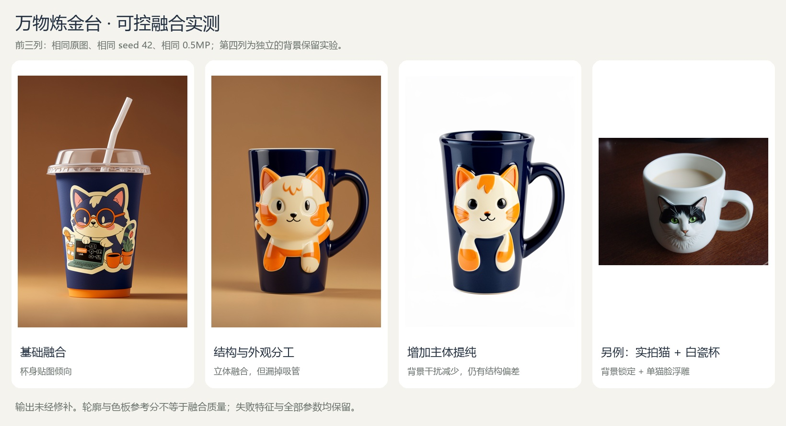

# 万物炼金台：实现方法与评价边界

本说明对应当前完整 Studio。早期双图复现已原样保留在 [BASELINE.md](BASELINE.md)，其中相对路径以原项目根目录为基准。完整使用方式见 [README](../README.md)。

## 课程问题与本次改进

具体需求是把宠物或角色照片做成可预览的定制商品设计：杯身、鞋面可以改，杯口、吸管、把手、鞋底等功能结构应尽量保留。原版双图生成能产生有趣图片，但容易多出把手、丢失吸管或污染桌面；只做提示词和漂亮界面，技术贡献确实偏薄。

当前核心功能因此收敛为“有保护区的双参考商品再设计”。允许自由生成，也允许用户在 A 图绘制修改区和保护区。不是把所有图像任务硬凑在一起：分割服务于编辑区域确定，生成服务于材料与角色融合，合成服务于结构保护，评测检验这三个环节。

## 区域约束：分割、潜空间采样与像素恢复

`studio/regions.py` 接收归一化矩形坐标，先取修改区并集、扣除保护区；分割可用时，再与 A 的前景概率 ≥ 0.5 区域相交，随后仅向内羽化。分割不可用时仍可手工画区域，实际策略写入记录。A 始终以完整场景送入模型；B 可单独提纯。自动前景相交会限制新造型超出原主体轮廓，适合结构保留，较大形变应使用自由生成。

区域蒙版不只用于最终贴图：它经 ComfyUI 原生 `SetLatentNoiseMask` 绑定到 **A 编码后的 latent**，替代原始空 latent 输入；双参考条件、模型、4 步 Euler 和 CFG=1 保持不变。A 先对齐到 16 像素尺寸，避免 VAE 隐式中心裁剪使蒙版错位。该接法基于现有原生节点，不是本项目发明的扩散算法。[ComfyUI VAE 实现](https://github.com/Comfy-Org/ComfyUI/blob/bdb0816a292d221efeb6ec4ae41bcdff3f91fc86/comfy/sd.py)、[采样实现](https://github.com/Comfy-Org/ComfyUI/blob/bdb0816a292d221efeb6ec4ae41bcdff3f91fc86/comfy/samplers.py)。

源分辨率的蒙版不能直接双线性缩小：一个很细的保护条可能完全消失。实现用积分图计算每个 latent 格覆盖的源像素；只要覆盖一个禁改像素，该格即为零，否则取柔和蒙版均值。若没有强度大于 0.5 的有效格，在推理前拒绝并提示扩大区域或提高分辨率。这是保守的尺度映射，会缩小可编辑范围。采样蒙版与最终像素蒙版分别保存。

生成后将输出映回 A 的画布，使用源坐标蒙版合成，逐像素检查蒙版为零的区域与规范化原图完全一致。保留原始生成、最终结果、实际蒙版及指标。**最终区域外零变化来自原像素恢复，不能当作模型本身的保真率。** VAE 解码和边界感受野仍影响原始输出；保守保护 latent 格也不代表对应输出像素完全不变，最终恢复只保证像素，不保证接缝自然。

### 预先规定的对照方法

脚本 `scripts/evaluate_regions.py` 在运行前保存 protocol：马克杯、透明饮料杯、运动鞋三类输入，每类 seed 42 / 123；每对使用相同 A/B、提示词、分辨率、模型和采样参数。依次比较自由生成原图、区域约束原图、区域约束后恢复的最终图。所有输出都留档，不挑最好的种子代替完整对照。

原始图的区域外平均绝对误差（MAE，0–255）以 **A 的 VAE 重建图**为参照，用来减小编码重建损失的干扰；同时报告区域内改变量，避免把“什么也没改”算作成功。最终图另外检查保护像素变化数。两者与角色识别、材质自然度、审美偏好是不同问题。人工评价表保留空白，供同学按角色可辨认、材质融合、功能结构、边缘自然四项 0/1/2 分填写，没有伪造评审得分。

第一轮仅使用矩形的 [完整对照](../output/region_evaluation/v1/comparison.jpg) 揭示了桌面被局部染色的失败，因此加入主体相交；第二轮保留在 v2。当前第三轮增加保守 latent 栅格化，全部 12 次生成完成，参数与测量见 [v3 结果](../output/region_evaluation/v3/results.json)，完整图见 [对照图](../output/region_evaluation/v3/comparison.jpg)。

| 物体 / seed | 自由生成区域外 MAE | 区域生成区域外 MAE |
| --- | ---: | ---: |
| 马克杯 / 42 | 18.305 | 4.947 |
| 马克杯 / 123 | 15.580 | 4.377 |
| 饮料杯 / 42 | 16.404 | 5.964 |
| 饮料杯 / 123 | 30.875 | 3.275 |
| 球鞋 / 42 | 4.585 | 0.330 |
| 球鞋 / 123 | 5.891 | 0.272 |

以上均是**合成前**相对 VAE 重建 A 的非编辑区 MAE。六对等权平均为 15.273 → 3.194，下降约 79.1%；不是按所有像素汇总的平均，也不是质量提高 79.1%。区域内 MAE 范围为 34.249–78.041，说明仍有实际编辑；这也不证明编辑正确。最终六张区域合成结果的保护像素变化数均为零。原始生成更少改变杯盖、把手和鞋面以外区域，但黑白猫仍变成红釉猫，鞋面也有贴图感；这些失败保留。

这只是三个选定物体、两个种子的工程消融，不足以证明任意照片上的成功率；角色身份、自然程度和分割漏检仍需单独评价。第一轮到第三轮属于迭代过程，主要成对对照使用第三轮内部的相同配置；不拿不同蒙版定义下的 MAE 直接宣称跨轮全面提升。

### 四人分工与七分钟展示

| 成员职责 | 可独立解释的工作 | 演示证据 |
| --- | --- | --- |
| 输入与分割 | 方向规范化、前景提取、A/B 差异化处理 | 原图与前景蒙版，透明物体漏分案例 |
| 区域生成 | 修改/保护集合运算、latent 输入、采样约束 | 同输入同种子的自由/区域原始输出 |
| 合成与评价 | 羽化、原像素恢复、MAE 与人工标准 | 原始/最终切换、区域外误差和失败图 |
| 交互与工程 | 区域编辑器、任务队列、历史和导出 | 现场上传、框选、生成、下载与记录 |

这是建议分工，实际提交必须按四个人真实完成的内容填写。七分钟可按“问题与失败 1 分钟 → 现场框选生成 2 分钟 → 分割与采样方法 1.5 分钟 → 对照与局限 1.5 分钟 → 分工和成果 1 分钟”组织。课程要求还包括 PPT、MP4 和每人理解自己的工作；可运行原型和这些材料不是同一项完成状态。

## 处理流程与项目增量

```text
图片 A：结构／用途 ─┐
                   ├─ 校正与规范化 → 角色对应的参考图处理
图片 B：外观／角色 ─┘                       │
配方＋用户补充 → 实际提示词编译 ────────────┤
                                            ↓
                 官方双参考工作流 → 逐个种子生成原始候选
                                            ↓
                 前景分析 → 可选背景合成 → 启发式排序
                                            ↓
                      人工选择＋全部候选／参数／中间图留档
```

生成部分复用 FLUX.2 klein 4B distilled 与 ComfyUI 原生两参考图图结构，量化配置为 FP8 生成模型、FP4 文本编码器；没有模型微调、新的扩散采样器或训练出的质量评估器。

本项目实现的增量包括：按结构／外观分工编译配方；A 保画布、B 聚焦前景的差异化处理；场景保留与生成前景联合的显式合成；可解释但有限的候选排序；带来源和实际执行参数的实验管理。它们构成可检验的课程方法与工程实现，不据此宣称通用算法首创。

## 提示词与参考图处理

基础对照使用简单融合说明；结构化配方明确 A 的轮廓、视角与功能部件，B 的配色、纹理与可见特征，并要求单物体物理融合。陶瓷、球鞋、毛绒、水晶和自由配方可附加用户原文，包括中文说明。人物、宠物和物品均可作参考；通用提示不硬编码猫脸或强制添加耳朵。

“单张脸”“保留吸管”等是模型指令，不能代替硬约束。工作流并未加入针对这些功能部件的检测器，因此不能保证遵循。

普通 RGB 输入使用本地 U2Netp 的 CPU ONNX 推理；核心预处理遵循 rembg 的 U2Netp 会话约定。模型文件在安装阶段显式下载并核验，执行阶段不下载模型。主体异常、位置偏离或不可靠的背景合成条件会显式报错。

| 选项 | A 的生成参考 | B 的生成参考 | 附加处理 |
| --- | --- | --- | --- |
| 不提纯、不锁背景 | 规范化原图 | 规范化原图 | 输出原始生成；仍可进行候选分析。 |
| 提纯、不锁背景 | 提取主体并用白色背景合成，保留画布 | 前景裁剪并留边、白底合成 | 分别保留原图坐标下的蒙版。 |
| 锁背景、不提纯 | 保留原始场景 | 规范化原图 | A 单独提取蒙版，用于输出合成。 |
| 锁背景且提纯 | 保留原始场景 | 前景裁剪、留边与白底合成 | A 单独提取蒙版；不把白底 A 送入生成器。 |

保留 A 场景可以避免生成时的白色背景被合成回原场景。输出尺寸跟随 A 比例及像素预算，合成阶段按原 A 画布等比适配，必要时留边，不做强制拉伸。

## 背景保留的精确含义

生成候选分割得到蒙版 `M_generated`，原 A 的蒙版为 `M_A`。取两者并集，再扩展柔和边缘，并限制在生成图有效覆盖范围内，得到 `M_edit`。合成遵循：

```text
output = M_edit × aligned_generation + (1 − M_edit) × original_A
```

联合原主体蒙版可以覆盖旧物体，联合生成蒙版可以容纳新增轮廓。原始生成、生成蒙版、最终合成和合成蒙版均保留。工作台支持切换原始生成与背景合成、查看蒙版，下载目标随当前视图切换；对应 [专项浏览器检查](../output/ui/background-browser-report.json) 已通过。

实现额外逐像素检查：**`M_edit == 0` 区域的 RGB 必须与规范化后的原 A 完全一致**。这是代码可核验的像素保证，范围由自动分割和合成蒙版决定。它不保证语义背景分割正确，也不保证半透明边缘、阴影、遮挡或新增部件自然。若生成主体位置明显偏离、等比适配遗漏原主体、或编辑区域几乎覆盖整张图，系统拒绝声称锁背景成功。

实测的两个锁背景候选分别检查了 4,484,165 和 4,485,452 个锁定像素，变化数均为 0。该数值不能写成“整张背景经人工确认 100% 保真”。

## 候选分数

`reference_heuristic_v2` 的输出范围是 0–100：

```text
score = 0.45 × shape_score
      + 0.25 × 100 × structure_similarity
      + 0.30 × 100 × palette_similarity
```

| 分项 | 实际计算 | 不代表什么 |
| --- | --- | --- |
| 前景形态 `shape_score` | 最大连通区域占比、贴边情况、前景面积合理性；内部权重分别为 0.45／0.30／0.25。 | 单物体语义正确、四肢或脸部数量正确。 |
| A 轮廓 `structure_similarity` | 对参考 A 与候选前景包围框等比归一、居中到 128 像素画布，再计算二值 IoU。 | 视角、空间位置、把手／吸管等功能件全部正确。 |
| B 配色 `palette_similarity` | 前景 HSV 75 桶直方图交集；含黑／灰／白与色相、饱和度、明度桶，排除背景干扰。 | 身份相同、角色识别正确或材质美观。 |

代码对小范围参考描述子缓存，避免重复分割同一参考；该分数用于提示候选中的轮廓与配色差异。参考描述子缺失或计算失败时退回 `mask_geometry_v1`，写入原因；分割不可用时可能没有分数。不同评分版本和降级结果也不应直接混用。

**反例必须保留：** 同输入、seed 42、0.5 MP 的一组对照中，基础提示生成的杯身贴图得分 **79.32**，结构化提示的立体融合结果得分 **64.05**。更接近原轮廓会提高分数，却可能恰好压低有创造性的结构变化；水晶、陶瓷等材质或照明变化也会降低配色分。

因此它不能判断融合语义、身份保真、审美、重复脸，也不能跨模式作为“融合质量提升”的指标。即便在同配方候选间，推荐也需要人工确认。

## 已有实验能够支持什么



图中前三组使用相同输入、seed 42 与 0.5 MP，分别展示基础提示、角色分工及主体提纯；第四组是独立的实拍猫马克杯背景保留案例，不能作为前三组的直接质量对照。展示图只排版原始结果，不修补生成内容。

固定配置见 [studio_ablation.json](../experiments/studio_ablation.json)，原始结果见 [results.json](../output/studio_eval/20261108T051221Z/results.json)。4 个任务生成 6 张图，完成了真实提交、双图生成、CPU 处理、排序、持久化与返回链路。基础对照和结构化配方保持相同输入、附加说明、seed 42 与 0.5 MP，可观察这一次角色提示改变的结果。

主体提纯组有两个种子；与单候选组比较质量时，应取相同 seed 的图，不能比较两张中挑出的最好图与另一组单张后声称公平胜出。锁背景组更换了输入，其目标是验证合成和记录完整性，不是与杯子基线直接比较融合质量。四个耗时是单轮任务观测，不能据此估计平均速度、置信区间或泛化成功率。

当前明确保留的限制包括贴图化、吸管遗漏、脸部／功能部件重复、分割误差、配色分偏好及背景边缘问题。早期视觉失败输出和当前全部候选不删除，不把“执行成功”记为“质量通过”。

当前自动测试为 18 项 API、24 项视觉处理与 23 项区域处理，共 65 项通过。API 使用替身推理检查上传限制、路径隔离、失败恢复、串行执行、取消与记录，视觉/区域测试验证蒙版、尺度、细保护条和评分行为。Playwright 驱动 Edge headless 实际完成新版框选生成与下载，任务耗时 9.060 秒。首轮换图遭遇 SSH 超时，完整记录未删除；恢复后对历史、换图与手机宽度补测通过，见 [首轮报告](../output/ui/region-browser-report.json) 和 [补测](../output/ui/region-browser-followup.json)。这些检查支持工程可运行性，不能代替视觉质量研究。

区域约束的六组成对工程实验已经完成。更广样本的角色提示、主体提纯等单因素消融，以及人工盲评物体一体性、B 特征可识别性、A 功能结构保留与偏好仍未完成；不得用这六组像素指标代替人工结论。

## 记录、恢复与归属

每个任务保存用户配置、实际编译提示词、工作流、模型文件名、候选种子、ComfyUI history、时间、预处理蒙版、原始生成及最终合成。前端 JSON 导出包含路径与来源信息；路径能否读取仍依赖对应 `input/`、`data/` 文件随项目保留。历史记录来自两台机器时，不跨机器时间戳直接相减。

任务由单工作进程依次执行；取消仅作用于本系统的阶段边界，不调用全局 ComfyUI interrupt。服务重启不会自动重提先前运行中的任务，以免重复生成；该任务会标记失败，已有候选继续可查。

上游代码、模型与素材的归属见 [README](../README.md) 和 [upstream_research.json](upstream_research.json)。InvokeAI 与 IOPaint 提供交互流程研究参考，未作为当前生成后端。U2Netp 采用已有公开权重，本项目实现参考图策略、合成、推荐与任务流程；不能把上游模型能力记为自研训练成果。
