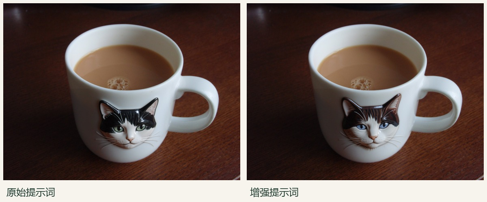

# 提示词增强测试

增强器将用户文字、用途、画风和编辑模式整理成三段指令，使用项目已有的 Qwen3-4B 权重。它不读取参考图片，图片由 FLUX.2 工作流处理。用户可修改增强结果、中止生成或回退原文。

## 环境

测试日期：2026-11-19 UTC。

| 项目 | 配置 |
| --- | --- |
| GPU | NVIDIA GeForce RTX 5070 Ti，16303MiB；8GB 未实测 |
| Python / PyTorch | 3.10.20 / 2.11.0+cu128 |
| ComfyUI | 0.44.0，`bdb0816a292d221efeb6ec4ae41bcdff3f91fc86` |
| 生图模型 | FLUX.2 Klein 4B distilled FP8 |
| 增强权重 | `qwen_3_4b_fp4_flux2.safetensors` |
| 权重 SHA256 | `3eab03a77adb0ee5304a4e677d5c10ac22f9049c1d7c894adca4f8bb39206ca8` |
| 后端回归 | 86 项测试、5 个子测试通过，5.27 秒 |

输入、两版文字输出、任务参数和显存数据见 [测试记录](../output/prompt_enhance_acceptance/results.json)。

## 文字结果

早期指令模板曾将换装范围缩成上半身、增加湿润材质，将局部去字误指向图 B，或混入不相符的梗图风格。调整后的模板明确用户原文优先、A/B 职责和选区归属，保留动作与表情，并增加单图清理示例。

| 案例 | 指令结果 | 耗时 |
| --- | --- | --- |
| ceramic_identity | 保留单张猫脸、敞口、茶水、右把手与木桌；不增加盖子和吸管 | 13.704 秒 |
| campus_architecture | 保留三段屋檐、四根红柱、中高两低形态，牌匾无字 | 16.525 秒 |
| meme_scene | 保留作业冒火与浣熊原表情、姿势的反差及饮料；像素风不混入低多边形 | 14.661 秒 |
| portrait_outfit | 保留脸、发型、姿势；替换蓝色雨衣，不增加帽子、道具和文字 | 12.930 秒 |
| local_remove_text | 清理 A 的牌匾伪字，沿用灰釉与光照，保留边框、屋檐和红柱 | 12.823 秒 |

五例均流式完成，三段格式完整；由 Codex 逐例定性复核，未发现违背所列要求的改写。测试仅覆盖五种固定输入，不是通用准确率评测。

## 图片对照

左侧使用原提示，右侧使用增强提示。两次固定马克杯与猫参考图、种子 42、0.5MP、陶瓷用途、原样风格、单候选；编辑框为 `[0.28, 0.48, 0.70, 0.90]`，开启局部高清，保护框为空，关闭提取主体和保留背景。

任务耗时分别为 20.369 秒与 17.216 秒，单次记录不能比较性能。两张均保留杯口、茶水、右侧把手和木桌，正面形成单张猫脸浅浮雕。增强图的猫眼偏蓝、部分毛色偏棕，原提示更接近参考猫的绿眼与黑白毛色。增强不保证改善质感或身份还原。

## 显存与调度

依次测试原提示生图、增强提示生图、生图缓存驻留后的增强与排队、增强取消后的生图。四个图像任务均成功。

| 检查 | 结果 |
| --- | --- |
| 生图缓存驻留后增强 | 释放 ComfyUI 驻留缓存后，Qwen 增强完成 |
| 增强时提交生图 | 新任务进入 queued；状态和历史接口可访问；增强结束后生图成功 |
| 输出后取消 | 收到真实文本增量后断开流；子进程回收，随后生图成功 |
| 五次增强整卡峰值 | 5149MiB；基线 618MiB；143 个样本 |
| 完整交替流程整卡峰值 | 9900MiB；基线 618MiB；207 个样本 |

显存采用 nvidia-smi 整卡采样，不是单进程占用。目标间隔为 0.5 秒；两组实际中位间隔均为 0.5001 秒，最大间隔为 0.5005 / 0.5077 秒。采样可能漏掉更短的峰值。pynvml 不可用时回退到 nvidia-smi，原因随记录保存。

## 运行机制

- 增强和生图共用 GPU 调度锁，子进程清理后才释放锁。
- 增强前检查 ComfyUI 队列与版本，释放驻留模型，检查 PyTorch 缓存和物理空闲显存。256MiB 缓存上限与 75% 空闲比例是保守调度阈值，不是模型显存需求。
- ChatML 会话以空 `llama_template` 送入 tokenizer，避免重复包装。
- stderr 按有界块读取；中止或断连时先结束子进程。
- 异常时恢复原提示词，切换历史任务时清空其他任务的回退栈。
- WSL 启动器支持盘符与 UNC 路径，验证复用服务的版本，仅清理自身创建的进程。

调度锁按 Studio 实例隔离，同一 GPU 应运行一个 Studio 实例。

## 接口与界面

Windows CPU 检查为 86 项测试、5 个子测试通过；无 PyTorch 的 WSL Python 3.10 环境为 85 项通过、1 项跳过，另有 5 个子测试通过。前端依赖安装与构建通过。

| 检查 | 方法 |
| --- | --- |
| 互斥、排队取消与异常恢复 | 接口测试和事件门控制的推理替身 |
| 管道与退出顺序 | 真实 Python 子进程输出大量无换行 stderr，验证退出先于解锁 |
| HTTP 断连 | ASGI http.disconnect 配合小子进程，验证清理与队列恢复 |
| 交接拒绝条件 | 模拟忙队列、错误版本及未满足释放条件的响应 |
| 流式交互 | 分块 HTTP SSE，覆盖 UTF-8/帧跨块、回退、错误、断流、中止与超时 |
| 窄屏 | 检查 360px、390px 状态的页面横向溢出 |
| 启动器 | PowerShell 解析、fake-WSL 参数、Python 服务预检与进程生命周期 |

模拟测试覆盖错误分支，真实模型测试覆盖增强输出与交替推理。

## 复现

启动 Studio 并安装 Qwen 权重后运行：

~~~bash
.venv/bin/python scripts/evaluate_prompt_enhance.py --server http://127.0.0.1:8890
~~~

案例位于 `experiments/prompt_enhance.json`，原提示、流式事件、增强结果、模型标识与耗时写入 `output/prompt_enhance/`。缺少模型、接口错误或流未完成时记录失败并停止。脚本检查三段格式，语义需逐项比对原文；图片对照固定 A/B、种子、区域与像素预算。
